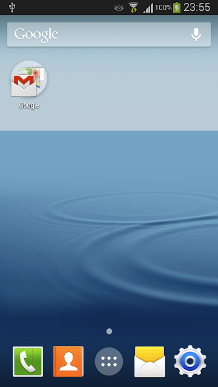
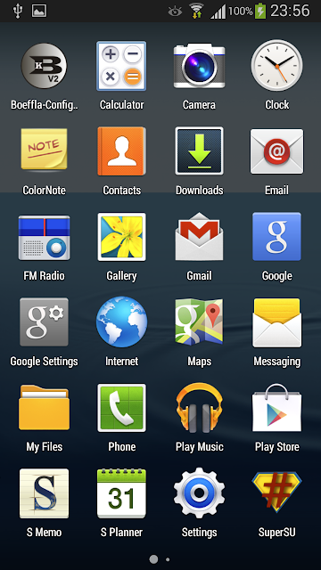
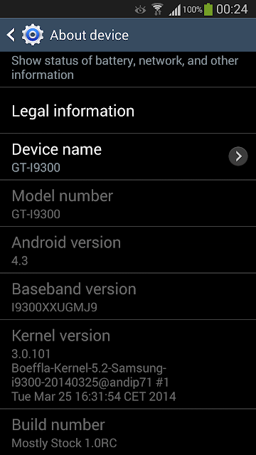

> This is an archive of an old custom ROM project I made around 2014. Somehow, I'm still getting requests for it in 2026.
>
> The ROM was originally hosted on Google Drive, but people keep requesting access, so I'm putting it on GitHub to make it easier to download.
>
> Below is the original XDA post from back in the day.
>
> If you're still rocking a Samsung Galaxy S3... enjoy!
<!-- Inline styles preserve the original forum appearance in compatible Markdown viewers.
     GitHub strips inline styles. The original screenshot's download targets are unknown. -->

<h2 style="color: #f23a12; font-family: Arial, sans-serif; font-size: 18px; margin: 0 0 18px;">Mostly Stock 1.0 (Release Candidate)</h2>

<strong>If you don't like to read, just click THIS to download and install using TWRP. Probably best to wipe the device first.</strong>

<strong>Based on Android 4.3, featuring a choice of stock or Android 4.4 launcher, and optimised for UK Galaxy S3 I9300 devices (only really in gps.conf)</strong>

 
 

<strong>* Not all apps shown above are included in the ROM.</strong>

 

I've been on XDA since 2006 and remember when I actually had an O2 XDA IIi.

Like many here, I've custom ROM'd pretty much every WinMo and Android device I've owned, and have come to the conclusion that I hate extra bloat in stock ROMs, but I also hate when custom ROM builders stray too far from the device's stock look and feel.

I also absolutely hate the self-promotion some ROM builders love to indulge in with their custom builds, where they add a stupid logo, boot sound or some god awful theme to let the world know that 'I MADE THIS'.

Also I'd never ask for a donation unless I actually made something myself...that is, I opened up my favourite IDE and actually wrote some code...rather than just bundle some other poor devs real effort into my own new self-promoting heavily branded package.

<strong>AND BREATHE.....</strong>

Allow me to introduce my own first custom ROM.

<strong>Mostly Stock 1.0</strong>

<strong>Important things to note are...</strong>

I made this for my own use, but figured that if someone else feels like I do, then maybe they'd like to use it as well. <strong>If you don't like this, use another ROM.</strong>

I've been testing the core version of this ROM for a good few days now but this is an RC release and I'm new to this game so if you find any issues, please let me know and I'll try to fix them. I haven't found any myself.

This is not an extreme custom ROM that is so 'optimised' some things don't work properly.

This ROM is just a de-bloat (again not extreme as I find some Samsung apps useful), a zip align, with a custom kernel and modem.

 

<strong>Ok, some features</strong>

<strong>* Choice of old launcher or new Android KitKat 4.4 launcher 
* Includes the brilliant Boeffla Kernel 5.2. Please get Boeffla Config V2 from Play Store for full control. 
* Features Galley 2013 (but I'm not sure if I like this so may downgrade in a future release). 
* Features modem XXUGMJ9 as I found boot issues with older modems 
* No stupid custom logos 
* No pleas for money 
* Samsung boot sound...I don't think this is a bad thing</strong>

<strong>Things to be added</strong>

* Removal of stupid EU volume warning 
* Placing some of the included apps (like the launcher) into the data folder so that they can be un-installed if they are not required

Please install using Team Win Recovery Project. It may work with ClockworkMod recovery too, but I've not tested this.

  

dsixda for the fantastic but sadly 'semi retired' Android Kitchen 
<a href="http://xdaforums.com/showthread.php?t=633246" style="color: #4ca5e7; text-decoration: none;">http://xdaforums.com/showthread.php?t=633246</a>

Andy Pfeiffer for Boeffla Kernel 
<a href="http://www.boeffla-kernel.de/index.php/about-the-kernel" style="color: #4ca5e7; text-decoration: none;">http://www.boeffla-kernel.de/index.php/about-the-kernel</a>

Chainfire 
<a href="http://www.chainfire.eu/" style="color: #4ca5e7; text-decoration: none;">http://www.chainfire.eu/</a>

Team Win 
<a href="http://teamw.in/project/twrp2" style="color: #4ca5e7; text-decoration: none;">http://teamw.in/project/twrp2</a>

Samsung for creating a device that is still awesome, nearly 2 years on.

I couldn't make this without you.

Cheers.

<!-- The screenshot does not expose the DOWNLOAD HERE or THIS link destinations. -->

<strong>DOWNLOAD HERE</strong>

<strong>Install using TWRP. Probably best to wipe the device first.</strong>

Last edited: Apr 28, 2014

